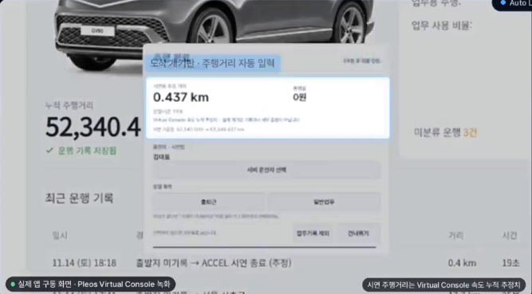
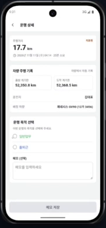
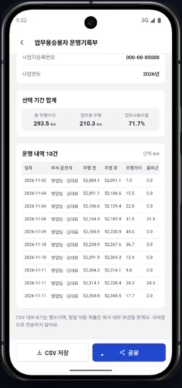

# AutoLog Pro

**팀명** · 법인 될 놈들

AutoLog Pro는 차량에서 공용 법인차의 운행을 기록하고, 직원이 휴대폰에서 운행 목적과 메모를 정리해 업무용 운행기록부를 만들 수 있는 Pleos Connect 기반 앱입니다.

## 전체 시연 영상

**무음 버전 · 2분 15초**

https://github.com/user-attachments/assets/74464e62-e52a-4369-a2fe-2e6f9adf5ef1

[소리 있는 전체 시연 영상 열기 (MP4 · 2분 15초)](./demo/AutoLogPro_Demo.mp4)

## 앱 화면

### 차량용 앱 · 주행 완료

### 휴대폰용 앱

| 운행 상세 | 업무용 운행기록부 |
| :---: | :---: |
|  |  |

## 프로젝트 구성

| 구성 | 소스 폴더 | 주요 기능 |
| --- | --- | --- |
| 차량용 앱 v1.6.13 | [`AutoLogPro_Vehicle_v1.6.13/`](./AutoLogPro_Vehicle_v1.6.13/) | 차량 신호 기반 운행 기록, 주차 후 음성 분류, 휴대폰 연결 QR, 운행기록부 내보내기 |
| 휴대폰용 앱 v0.3.4 | [`AutoLogPro_Companion_v0.3.4/`](./AutoLogPro_Companion_v0.3.4/) | 회사 계정 로그인, 차량 QR 스캔, 운행 목적·메모 수정, 운행기록부 조회 및 저장 |

두 앱은 Supabase를 통해 운행기록을 동기화합니다. 차량 연결 QR은 차량을 선택하는 데 사용하며, 로그인과 기록 조회 권한을 대신하지 않습니다.

## APK 설치 및 실행

| 용도 | APK 파일 | 설치 환경 |
| --- | --- | --- |
| 차량용 · 공식 제출 | [법인 될 놈들_AutoLog Pro_release.apk](<./apk/법인 될 놈들_AutoLog Pro_release.apk>) | Pleos Connect 에뮬레이터 |
| 휴대폰용 · 연동 테스트 | [법인 될 놈들_AutoLog Pro_Companion_release.apk](<./apk/법인 될 놈들_AutoLog Pro_Companion_release.apk>) | Pixel 9 등 일반 Android 에뮬레이터 |

1. Android Studio의 **Device Manager**에서 차량용은 **Pleos Connect**, 휴대폰용은 **Pixel 9** 에뮬레이터를 실행합니다.
2. 각 APK를 내려받아 해당 에뮬레이터 화면에 끌어다 놓아 설치합니다.
3. 설치가 끝나면 에뮬레이터의 앱 목록에서 **AutoLog Pro**를 실행합니다.

소스에서 실행하려면 Android Studio에서 각 앱 폴더를 **별도 프로젝트**로 열고, Gradle 동기화가 끝난 뒤 해당 에뮬레이터를 선택합니다.

## 개발 및 테스트 환경

- **개발 환경** · Windows, Android Studio
- **차량용 에뮬레이터** · Pleos Connect Emulator v2.1.0, Android API 34
- **차량 화면 규격** · 가로 분할 화면. 개발 시 참고한 캡처 기준으로 전체 화면은 약 1200 × 690 px, 앱이 표시되는 오른쪽 영역은 약 790 × 560 px입니다. 캡처 기준 크기이며 에뮬레이터의 실제 해상도와는 다를 수 있습니다.
- **휴대폰용 에뮬레이터** · Pixel 9, Android API 35, 세로 화면
- **차량 신호 테스트** · Pleos 에뮬레이터를 Cold Boot로 실행하고 Virtual Console을 사용합니다. 제출용 APK에는 디버그용 `시연 주행` 버튼이 제공되지 않습니다.
- **서버 연동 조건** · 인터넷 연결과 승인된 차량 단말 계정 및 회사 직원 계정이 필요합니다. 휴대폰 앱의 `데모로 시작`은 로그인 없이 이용할 수 있습니다.

## 차량·휴대폰 연동 확인

## 심사용 테스트 계정

아래 계정은 심사용 시연 계정입니다. 실제 회사 데이터나 관리자 계정은 사용하지 않습니다.

| 용도 | 로그인 이메일 | 비밀번호 | 권한 및 확인 범위 |
| --- | --- | --- | --- |
| 차량 앱 | `car@demo.autolog.invalid` | `bm78-xw54` | 차량 단말(`vehicle`) · `12가3456 제네시스 GV90` |
| 휴대폰 앱 | `lee.sales@demo.autolog.invalid` | `zAYCt1yNc7jTAXdBGAKjnvro` | 일반 직원(`employee`) · 이영업에게 배정된 시연 운행만 조회·수정 가능 |

**연동 확인 시 차량 앱에서 운전자를 `이영업 · 영업팀`으로 지정해 주세요.** 운전자가 미지정이거나 다른 직원으로 지정된 운행은 이 휴대폰 계정에 표시되지 않습니다.

1. 차량 앱에서 **설정 → Supabase 차량 로그인**으로 이동해 차량 단말 계정으로 로그인합니다.
2. 주차 상태에서 차량 앱의 **휴대폰 연결 QR**을 열고, 휴대폰 앱에서 **차량 QR 스캔**을 선택합니다. 휴대폰 앱에는 위의 직원 계정으로 로그인합니다.
3. 차량 앱에서 운전자를 **이영업 · 영업팀**으로 지정한 뒤 시연 운행을 기록합니다.
4. 휴대폰 앱에서 같은 차량을 선택하고 운행기록을 새로고침합니다. 해당 운행의 목적과 메모를 수정할 수 있습니다.

휴대폰 앱의 화면만 확인하려면 로그인 없이 **데모로 시작**을 선택할 수 있습니다.

> 두 계정의 로그인과 운전자 지정 전후의 조회·수정 권한은 서버 API로 확인했습니다. 에뮬레이터에서 두 앱을 설치해 화면 조작으로 연동하는 테스트는 별도로 진행하지 않았습니다.

1. 차량 앱의 **설정 → Supabase 차량 로그인**에서 차량 단말 계정으로 로그인합니다.
2. 주차 상태에서 **설정 → 휴대폰 연결 QR**을 엽니다. 휴대폰 앱에서 **차량 QR 스캔**을 누르고, 회사 직원 계정으로 로그인합니다.
3. 차량 앱에서 해당 직원을 운전자로 지정한 뒤 운행을 기록합니다. 휴대폰 앱에서 같은 차량을 선택하고 운행기록을 새로고침합니다.
4. 휴대폰에서 운행 목적을 **일반업무**로 바꾸고 메모를 저장합니다. 차량 앱의 **설정 → 운행기록 동기화**를 누른 뒤 같은 운행 상세에서 변경 내용을 확인합니다.

위 심사용 시연 계정 외에 실제 운영 계정의 비밀번호, 서버 관리자 키, APK 서명 키 및 참가신청서는 저장소에 포함하지 않습니다.

## 이미지 출처

[제네시스 GV90 공식 페이지](https://www.genesis.com/kr/ko/models/gv90)의 세빌 실버 외장 이미지에서 배경을 제거해 시연 화면에 사용했습니다.
